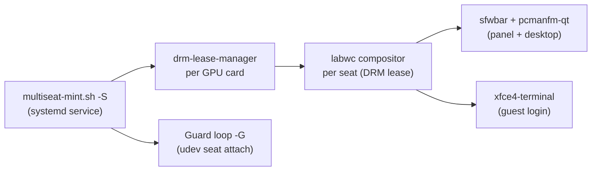

# Multiseat Mint — Launch & Operation Guide

> [!NOTE]
> This guide covers **`multiseat-mint.sh`** — the Linux Mint / Ubuntu Noble (24.04) adaptation of the multiseat system. It enables multiple independent desktops on a **single GPU** using DRM leases and Wayland compositors (labwc), without Xephyr or any nested display server.

---

## How It Works



Each physical monitor/output is assigned its own seat with its own user session. The DRM lease grants exclusive GPU access per output without a separate GPU.

---

## Prerequisites

- **OS:** Linux Mint 22.3 Zena (Ubuntu Noble 24.04 base)
- **Kernel:** 6.14+ with DRM lease support
- **Systemd:** 255+
- **Root access** required for all operations
- All monitors and USB peripherals connected before running `-c`

---

## First-Time Setup

### Step 1 — Build Everything (automatic)

```bash
sudo ./multiseat-mint.sh -a
```

This single command:
1. Runs `-b` — installs apt packages, git-clones and compiles:
   - `tomlc99` — TOML config parser
   - `drm-lease-manager` — DRM lease daemon
   - `wlroots 0.20` (patched for lease multiseat)
   - `labwc` — Wayland compositor
   - `sfwbar` — status bar
   - `wlopm` — display power management
2. Runs `-c` — interactive config wizard (detect monitors, keyboards, mice, USB)
3. Prompts whether to switch to `multi-user.target` *(see warning below)*
4. Runs `systemctl enable multiseat` — enables boot autostart

> [!WARNING]
> On Linux Mint, the system default target is `graphical.target` (managed by **lightdm**). Switching to `multi-user.target` **disables lightdm** and hands all seat management to multiseat. Only confirm `[y]` if you intend multiseat to be the *only* display manager. If unsure, answer **N** and start multiseat manually.

---

### Step 2 — Review & Edit Config

After `-c` runs `nano` opens `/etc/multiseat/<hardware-id>.conf`. Each block represents one seat:

```
card0-HDMI-A-1          # seat/output name (leaseable CRTC)
    usbk 1d.0-1.1       # USB keyboard path
    usbm 1d.0-1.2       # USB mouse path
    usbd 1d.0-1.3       # other USB device (passed through)

card0-VGA-1             # second seat on same card
    usbk 1d.0-2.1
    usbm 1d.0-2.2
```

Optional per-seat overrides:
```
    comp labwc          # custom compositor command
    open alacritty      # app to launch at session start
```

> [!TIP]
> The config filename is auto-derived from your hardware PCI/DRM paths. A symlink is created at `/tmp/multiseat.conf` for quick inspection.

---

### Step 3 — Create Library Links & Service

If you ever update `multiseat-mint.sh` or need to refresh systemd links:

```bash
sudo ./multiseat-mint.sh -l
```

This:
- Creates `/etc/systemd/system/multiseat.service` (ordered `Before=display-manager.service`)
- Soft-links built libraries from `/usr/local/` → `/usr/`
- Refreshes `ldconfig` cache
- Creates `/home/multiseat/` and `/etc/multiseat/` directories

---

## Launching Multiseat

### Manual Start (interactive, foreground)

```bash
sudo ./multiseat-mint.sh -s
```

Press **Enter** when prompted to release the root TTY session.

### Manual Start (detached / no TTY release)

```bash
sudo ./multiseat-mint.sh -S
```

Used by the systemd service. Skips the interactive TTY wait.

### Start at Boot

```bash
sudo systemctl enable multiseat
sudo reboot
```

> [!IMPORTANT]
> **Before each boot test** while the reboot flow is not yet stable, temporarily add the self-disable line at the top of the script:
> ```bash
> [[ "-S" == "$1" ]] && systemctl disable multiseat
> ```
> This prevents a boot loop if multiseat crashes early. Remove it once your config is stable.

---

## Runtime Operations

### Restart a Single Seat

```bash
# By seat position (1st, 2nd, …)
sudo ./multiseat-mint.sh -r 1

# By lease name (CRTC name from config)
sudo ./multiseat-mint.sh -r card0-HDMI-A-1

# Restart with a specific user
sudo ./multiseat-mint.sh -r 1 alice
```

### Stop All Seats

```bash
sudo ./multiseat-mint.sh -q     # stop + restore TTY1 / lightdm
sudo ./multiseat-mint.sh -Q     # stop only (no TTY restore)
```

### Start DRM Lease Manager Only

```bash
sudo ./multiseat-mint.sh -d
```

Clears stale leases in `/var/local/run/drm-lease-manager/` then starts a `drm-lease-manager` transient service per detected `/dev/dri/card*`.

---

## GUI Control Panel

```bash
# Install once
sudo ./multiseat-mint.sh -I

# Run (after install)
pkexec multiseat-gui
```

Or launch **Multiseat Control Panel** from your application menu.

---

## Viewing Logs

```bash
# Current boot
sudo ./multiseat-mint.sh -j

# Previous boot
sudo ./multiseat-mint.sh -j -1

# Raw systemd units
journalctl -u "multiseat-*" -u "dlm-*" --no-hostname -b
```

---

## Updating & Rebuilding

| Situation | Command |
|---|---|
| After `apt upgrade` | `sudo ./multiseat-mint.sh -b 1 2 3 4` |
| After kernel/drm update | `sudo ./multiseat-mint.sh -b 1` then `-c` |
| After updating `multiseat-mint.sh` | `sudo ./multiseat-mint.sh -l` |
| Re-detect hardware config | `sudo ./multiseat-mint.sh -c` |
| Flush/reset seat assignments | `sudo ./multiseat-mint.sh -f` |
| Fresh clone from scratch | `sudo rm -R /home/multiseat && sudo ./multiseat-mint.sh -b` |

Build IDs for `-b`:

| ID | Component |
|---|---|
| 0 | tomlc99 |
| 1 | drm-lease-manager |
| 2 | wlroots 0.20 (patched) |
| 3 | labwc |
| 4 | sfwbar |
| 5 | wlopm |

---

## Command Reference

```
./multiseat-mint.sh <flag>

  -a          Auto: build + config + enable service (first-time setup)
  -b [ID]     Build component by ID (omit ID = build all)
  -c          Interactive config wizard (detects and writes /etc/multiseat/*.conf)
  -C          Config wizard, no editor (for scripting)
  -s          Start services (interactive — waits for TTY release)
  -S          Start services (non-interactive — used by systemd)
  -q          Stop all multiseat services, restore TTY1
  -Q          Stop all multiseat services (no TTY restore)
  -r [LEASE]  Restart compositor for seat [with optional user]
  -d          Start drm-lease-manager services
  -G          Start seat guard (device attachment loop)
  -g          Git clone/update repos only (no build)
  -l          Create systemd service + library symlinks
  -f          Flush/disable seat config (loginctl flush-devices)
  -p          Generate wlroots patch file
  -j [BOOT]   View journal logs (optionally -1 for previous boot)
  -I          Install GUI control panel
  -u          Uninstall all multiseat configs & restore default single-seat display
```

---

## Uninstalling & Restoring Single-Seat Display

To completely remove all multiseat configurations, services, udev rules, and auto-generated seat users, and restore Linux Mint to standard `graphical.target` (LightDM / single seat):

### From User Terminal:
```bash
# Using multiseat-mint.sh
sudo ./multiseat-mint.sh -u

# Or using the standalone script
sudo ./multiseat-uninstall.sh
```

### From Recovery Mode Root Shell:
If your display freezes or LightDM fails:
1. Boot into GRUB -> **Advanced options for Linux Mint** -> select **(recovery mode)**.
2. Select **root (Drop to root shell prompt)**.
3. If mounted read-only, remount read-write:
   ```bash
   mount -o remount,rw /
   ```
4. Run the uninstaller:
   ```bash
   multiseat-uninstall
   # Or directly:
   /home/senay/Desktop/multiseat/multiseat-uninstall.sh
   ```
5. Reboot:
   ```bash
   reboot
   ```

---

## Troubleshooting

| Symptom | Fix |
|---|---|
| `Config 'conf' not found!` at boot | Run `-c` to generate config, then `-l` |
| Seat compositor not starting | Check `journalctl -u multiseat-card*` and ensure DRM output is connected |
| Kiosk/app fails to start | A connected (and detected) DRM output is required |
| Seat stuck after reboot | Add `systemctl disable multiseat` temporarily at top of `-S` block |
| USB device wrong ownership | Guard loop (-G) handles this every 9s; check `/tmp/usb_user_fail.log` |
| Library not found errors | Run `-l` to refresh symlinks and `ldconfig` |
| Need to check last exit code | `echo $?` immediately after the failed command |
