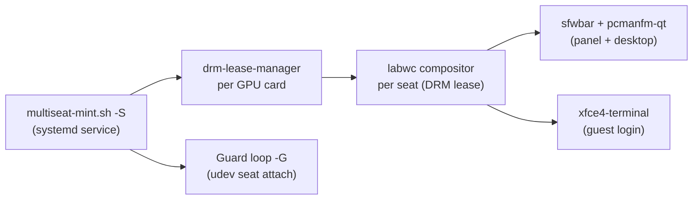

# Multiseat Mint — Launch & Operation Guide

> [!NOTE]
> This guide covers **`multiseat-mint.sh`** — the Linux Mint / Ubuntu Noble (24.04) adaptation of the multiseat system. It enables multiple independent desktops on a **single GPU** using DRM leases and Wayland compositors (labwc), without Xephyr or any nested display server.
>
> You can do everything from the **Control Panel (GUI)** or from the **command line**. They share the same config file and the same commands, so you can mix them freely, and the command line always works for crashes and recovery.

---

## How It Works



Each physical monitor/output is assigned its own seat with its own user session. The DRM lease grants exclusive access to one output per seat, so no second GPU is needed.

---

## Prerequisites

- **OS:** Linux Mint 22.3 Zena (Ubuntu Noble 24.04 base)
- **Kernel:** 6.14+ with DRM lease support
- **Systemd:** 255+
- **Root access** required for all operations (the GUI asks for your password once)
- All monitors and USB peripherals connected before configuring seats

---

## Quick Start with the Control Panel (GUI)

The Control Panel is `multiseat-gui.py`, a GTK3 window in the spirit of ASTER on Windows: you see your monitors as seats and point keyboards and mice at them, instead of editing text files.

### Install and open

```bash
cd ~/Desktop/multiseat          # folder containing multiseat-mint.sh and multiseat-gui.py
sudo ./multiseat-mint.sh -I     # installs /usr/local/bin/multiseat-gui + menu launcher
multiseat-gui                   # or: "Multiseat Control Panel" in the application menu
```

You can also run it straight from the folder: `python3 multiseat-gui.py`.

- It re-launches itself as root through `pkexec` (password prompt) and finds `multiseat-mint.sh` automatically. If it cannot, a yellow banner offers **Locate script…**.
- `pkexec multiseat-gui` and `sudo multiseat-gui` also work. The GUI recovers `DISPLAY`/`XAUTHORITY` from the calling user.
- Needs `python3-gi` and `gir1.2-gtk-3.0` (installed by `-gp`, or `sudo apt install python3-gi gir1.2-gtk-3.0`).
- After updating `multiseat-gui.py`, copy it again: `sudo cp multiseat-gui.py /usr/local/bin/multiseat-gui`.

### Step 1 — Home tab: install components

The **Components** box shows a ✔ or ✘ for each of: tomlc99, drm-lease-manager, wlroots (patched), labwc, sfwbar, wlopm.

Press **Install / build components**. This runs `multiseat-mint.sh -b` (apt packages, git clone, patch, compile). It takes a while; progress streams into the **Command output** panel at the bottom of the window. When it finishes, the GUI tells you if anything is still missing. If so, scroll up in the output to the first error, fix it, and rebuild a single component from **Advanced → Build one component**.

### Step 2 — Seats tab: assign devices

Every connected monitor appears as a **seat card**, named from the monitor's own EDID data (for example "Dell U2412M 1920x1200").

1. Press **📺 Show seat numbers on monitors** to flash a big number on each screen. This works best when the screens are all in the current desktop; the match to the kernel connector name is best-effort.
2. On a seat card press **🎯 Identify…**, then on the keyboard and mouse that belong to that seat press a key and move or click the mouse. Each device appears in the dialog and is added to the seat immediately. Press **Done** when finished.
3. Anything missed can be added with **➕ Add device**; a device already used by another seat is offered as "move from Seat N". **✕** removes a device from a seat.
4. **✨ Auto-assign** gives each seat that has no keyboard or mouse the next free one. It is only a guess, so verify with Identify.
5. The switch on a card enables or disables that seat. A disabled seat is written as `#card0-…` in the config.
6. The card's **Advanced** section sets a custom compositor (`comp`) or a start app (`open`).
7. Press **💾 Save configuration**. The old file is kept next to it as `.bak`.

Devices left in the **Not assigned** card stay on the main seat (`seat0`). Unplugged devices that are still in the config show "(not connected)" so you do not lose them.

### Step 3 — Home tab: run

| Button | What it does | Command equivalent |
|---|---|---|
| **▶ Start now** | Starts all seats | `-S` |
| **■ Stop** | Stops all seats | `-q` (or `-Q` if a login screen is running) |
| **⏻ Enable at boot…** | Installs and enables the service, optionally boots to text mode and turns on the first-boot safety | `-l`, `systemctl enable multiseat`, `systemctl set-default multi-user.target` |
| **↩ Back to normal login…** | Stops multiseat, disables it, restores the graphical login (config is kept) | `-Q`, `systemctl disable multiseat`, `systemctl set-default graphical.target` |

The **Run** box also shows the service state, the boot target, whether a display manager is running, and how many seats and GPU leases are up. It refreshes every few seconds.

> [!WARNING]
> **Start now** from inside a running desktop usually fails or freezes the screen when lightdm owns the GPU, because only one process can be DRM master. The GUI warns you first. The reliable path is **Enable at boot…**, then reboot.

**Boot test mode.** The switch at the bottom of the Run box makes the service disable itself every time it starts, so a freeze at boot cannot repeat. Turn it on for first tests. You must re-enable the service (**Enable at boot…**) before each boot test. Turn it off once boots are stable.

### Other tabs

- **📜 Logs** shows the journal filtered to multiseat, labwc, seat, DRM lease and plymouth lines, with a *Previous boot* option and a *Show everything* option.
- **🛠 Advanced / Recovery** has a button for every script flag, *Build one component*, *Restart one seat*, **Uninstall everything**, **Reboot**, a copy-paste list of recovery commands, and a raw config editor (changes reload into the Seats tab).

---

## Quick Start from the Command Line

Everything the GUI does is a script command. This section is also what you use over SSH, from a text console, or in recovery mode.

### Step 1 — Build Everything (automatic)

```bash
sudo ./multiseat-mint.sh -a
```

This single command:
1. Runs `-b` — installs apt packages, git-clones and compiles:
   - `tomlc99` — TOML config parser
   - `drm-lease-manager` — DRM lease daemon
   - `wlroots 0.20` (patched for lease multiseat)
   - `labwc` — Wayland compositor
   - `sfwbar` — status bar
   - `wlopm` — display power management
2. Runs `-c` — interactive config wizard (detect monitors, keyboards, mice, USB)
3. Prompts whether to switch to `multi-user.target` *(see warning below)*
4. Runs `systemctl enable multiseat` — enables boot autostart

> [!WARNING]
> On Linux Mint, the system default target is `graphical.target` (managed by **lightdm**). Switching to `multi-user.target` **disables lightdm** and hands all seat management to multiseat. Only confirm `[y]` if you intend multiseat to be the *only* display manager. If unsure, answer **N** and start multiseat manually.

---

### Step 2 — Review & Edit Config

After `-c` runs, `nano` opens `/etc/multiseat/_<hardware-id>.conf`. The GUI reads and writes this same file. Each block is one seat:

```
card0-HDMI-A-1                        # seat/output name (leaseable connector)
	usbk 0000:00:1d.0-1.1         #- USB keyboard  (PCI address - USB port)
	usbm 0000:00:1d.0-1.2         #- USB mouse
	usbd 0000:00:1d.0-1.3         #- other USB device (ownership passed to the seat user)

card0-VGA-1                           # second seat on same card
	usbk 0000:00:1d.0-2.1
	usbm 0000:00:1d.0-2.2

#card0-DVI-I-1                        # a leading # disables a seat
```

Device lines are `usbk`/`usbm`/`usbd` for USB and `ps2k`/`ps2m` for PS/2. The text after `#-` is only a label.

Optional per-seat overrides:
```
	comp labwc          # custom compositor command
	open alacritty      # app to launch at session start
```

> [!TIP]
> The config filename is auto-derived from your hardware PCI/DRM paths. A symlink is created at `/tmp/multiseat.conf` for quick inspection.

---

### Step 3 — Create Library Links & Service

If you ever update `multiseat-mint.sh` or need to refresh systemd links:

```bash
sudo ./multiseat-mint.sh -l
```

This:
- Creates `/etc/systemd/system/multiseat.service` (ordered `Before=display-manager.service`)
- Soft-links built libraries from `/usr/local/` → `/usr/`
- Refreshes `ldconfig` cache
- Creates `/home/multiseat/` and `/etc/multiseat/` directories

---

## Launching Multiseat

### Manual Start (interactive, foreground)

```bash
sudo ./multiseat-mint.sh -s
```

Press **Enter** when prompted to release the root TTY session.

### Manual Start (detached / no TTY release)

```bash
sudo ./multiseat-mint.sh -S
```

Used by the systemd service and by the GUI's **Start now**. Skips the interactive TTY wait.

### Start at Boot

```bash
sudo systemctl enable multiseat
sudo reboot
```

> [!IMPORTANT]
> **Before each boot test** while the reboot flow is not yet stable, turn on the self-disable safety. In the GUI, use the **Boot test mode** switch on the Home tab. By hand, uncomment this line near the top of the script:
> ```bash
> [[ "-S" == "$1" ]] && systemctl disable multiseat
> ```
> This prevents a boot loop if multiseat crashes early. Turn it off again once your config is stable.

---

## Runtime Operations

### Restart a Single Seat

```bash
# By seat position (1st, 2nd, …)
sudo ./multiseat-mint.sh -r 1

# By lease name (CRTC name from config)
sudo ./multiseat-mint.sh -r card0-HDMI-A-1

# Restart with a specific user
sudo ./multiseat-mint.sh -r 1 alice
```

GUI: **Advanced → Restart one seat**.

### Stop All Seats

```bash
sudo ./multiseat-mint.sh -q     # stop + restore TTY1 / lightdm
sudo ./multiseat-mint.sh -Q     # stop only (no TTY restore)
```

> [!NOTE]
> `-q` switches virtual terminals. Do not use it from inside a running desktop; use `-Q`. The GUI chooses this for you.

### Start DRM Lease Manager Only

```bash
sudo ./multiseat-mint.sh -d
```

Clears stale leases in `/var/local/run/drm-lease-manager/` then starts a `drm-lease-manager` transient service per detected `/dev/dri/card*`.

---

## Viewing Logs

```bash
# Current boot
sudo ./multiseat-mint.sh -j

# Previous boot
sudo ./multiseat-mint.sh -j -1

# Raw systemd units
journalctl -u "multiseat-*" -u "dlm-*" --no-hostname -b
```

GUI: **Logs** tab.

---

## Updating & Rebuilding

| Situation | Command |
|---|---|
| After `apt upgrade` | `sudo ./multiseat-mint.sh -b 1 2 3 4` |
| After kernel/drm update | `sudo ./multiseat-mint.sh -b 1` then re-detect devices (`-c` or the Seats tab → Detect hardware) |
| After updating `multiseat-mint.sh` | `sudo ./multiseat-mint.sh -l` |
| After updating `multiseat-gui.py` | `sudo cp multiseat-gui.py /usr/local/bin/multiseat-gui` |
| Re-detect hardware config | `sudo ./multiseat-mint.sh -c` |
| Flush/reset seat assignments | `sudo ./multiseat-mint.sh -f` |
| Fresh clone from scratch | `sudo rm -R /home/multiseat && sudo ./multiseat-mint.sh -b` |

Build IDs for `-b`:

| ID | Component |
|---|---|
| 0 | tomlc99 |
| 1 | drm-lease-manager |
| 2 | wlroots 0.20 (patched) |
| 3 | labwc |
| 4 | sfwbar |
| 5 | wlopm |

---

## Command Reference

```
./multiseat-mint.sh <flag>

  -a          Auto: build + config + enable service (first-time setup)
  -b [ID]     Build component by ID (omit ID = build all)
  -c          Interactive config wizard (detects and writes /etc/multiseat/*.conf)
  -C          Config wizard, no editor (for scripting)
  -s          Start services (interactive — waits for TTY release)
  -S          Start services (non-interactive — used by systemd)
  -q          Stop all multiseat services, restore TTY1
  -Q          Stop all multiseat services (no TTY restore)
  -r [LEASE]  Restart compositor for seat [with optional user]
  -d          Start drm-lease-manager services
  -G          Start seat guard (device attachment loop)
  -g          Git clone/update repos only (no build)
  -gp         Install apt packages only
  -l          Create systemd service + library symlinks
  -f          Flush/disable seat config (loginctl flush-devices)
  -p          Generate wlroots patch file
  -j [BOOT]   View journal logs (optionally -1 for previous boot)
  -I          Install GUI control panel
  -u          Uninstall all multiseat configs & restore default single-seat display
```

GUI equivalents: Home tab buttons cover `-b`, `-S`, `-q/-Q`, `-l`; the Advanced tab has a button for each remaining flag.

---

## Uninstalling & Restoring Single-Seat Display

To completely remove all multiseat configurations, services, udev rules, and auto-generated seat users, and restore Linux Mint to standard `graphical.target` (LightDM / single seat):

### From the GUI
- **Home → ↩ Back to normal login…** keeps your seat config and just switches back.
- **Advanced → Uninstall everything (-u)…** removes everything, including `/etc/multiseat`.

### From User Terminal:
```bash
# Using multiseat-mint.sh
sudo ./multiseat-mint.sh -u

# Or using the standalone script
sudo ./multiseat-uninstall.sh
```

### From Recovery Mode Root Shell (no GUI needed):
If your display freezes or LightDM fails:
1. Boot into GRUB -> **Advanced options for Linux Mint** -> select **(recovery mode)**. (Or press **Ctrl+Alt+F3** for a text console if the machine still responds.)
2. Select **root (Drop to root shell prompt)**.
3. If mounted read-only, remount read-write:
   ```bash
   mount -o remount,rw /
   ```
4. Run the uninstaller, or just undo the boot change:
   ```bash
   multiseat-uninstall
   # Or directly:
   /home/senay/Desktop/multiseat/multiseat-uninstall.sh

   # Lighter option, keeps your config:
   systemctl disable multiseat
   systemctl set-default graphical.target
   ```
5. Reboot:
   ```bash
   reboot
   ```

---

## Troubleshooting

| Symptom | Fix |
|---|---|
| GUI: `Cannot open the display` | Use the current `multiseat-gui.py` (copy it to `/usr/local/bin/multiseat-gui`) and run it as your normal user, or via `pkexec multiseat-gui` |
| GUI: yellow "script was not found" banner | Press **Locate script…** and pick `multiseat-mint.sh` |
| GUI: component shows ✘ after build | Read the Command output for the first error; rebuild one component from Advanced → Build |
| GUI: Seats tab shows no monitors | Connect monitors, press **Detect hardware**; check `cat /sys/class/drm/card*-*/status` |
| `Config 'conf' not found!` at boot | Save the config on the Seats tab (or run `-c`), then `-l` |
| Seat compositor not starting | Check `journalctl -u multiseat-card*` and ensure DRM output is connected |
| Kiosk/app fails to start | A connected (and detected) DRM output is required |
| Seat stuck after reboot | Turn on **Boot test mode** (or add `systemctl disable multiseat` at the top of the `-S` block) |
| Freeze on the Mint boot logo | Boot to recovery mode and run `systemctl disable multiseat`; a running login screen and multiseat compete for the GPU |
| Login screen shows an unknown `u0-vga-1` user | Auto-created seat user with a locked password; `-u` removes it |
| USB device wrong ownership | Guard loop (-G) handles this every 9s; check `/tmp/usb_user_fail.log` |
| Library not found errors | Run `-l` to refresh symlinks and `ldconfig` |
| Need to check last exit code | `echo $?` immediately after the failed command |
